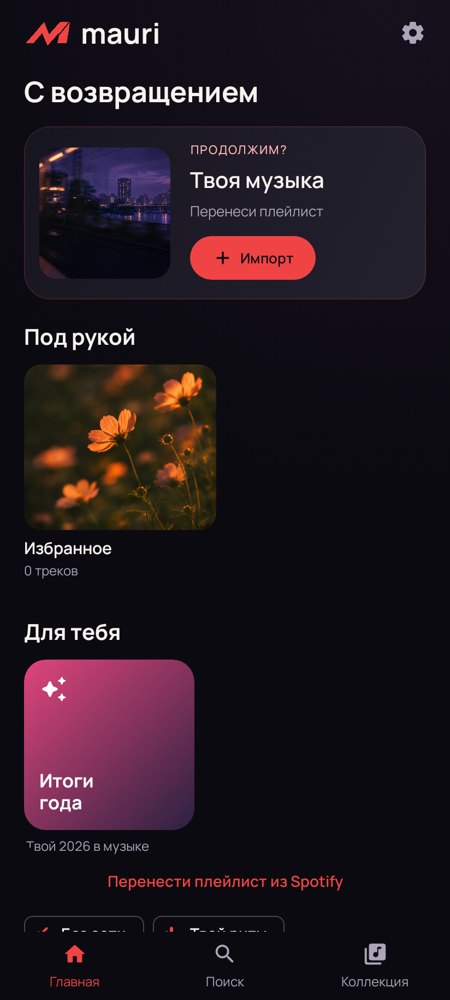
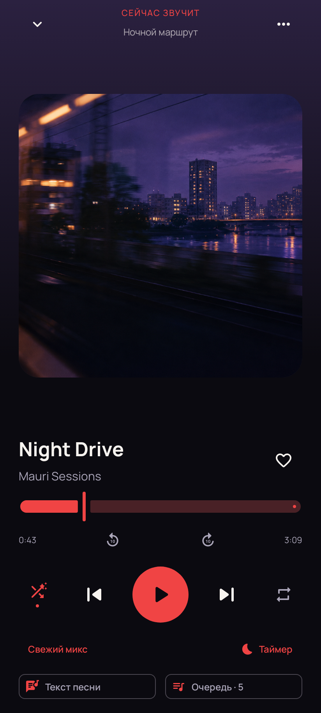
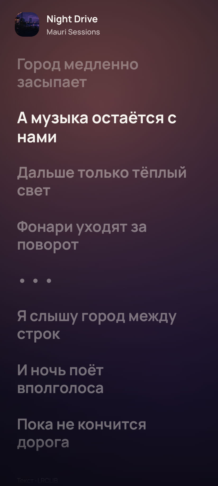
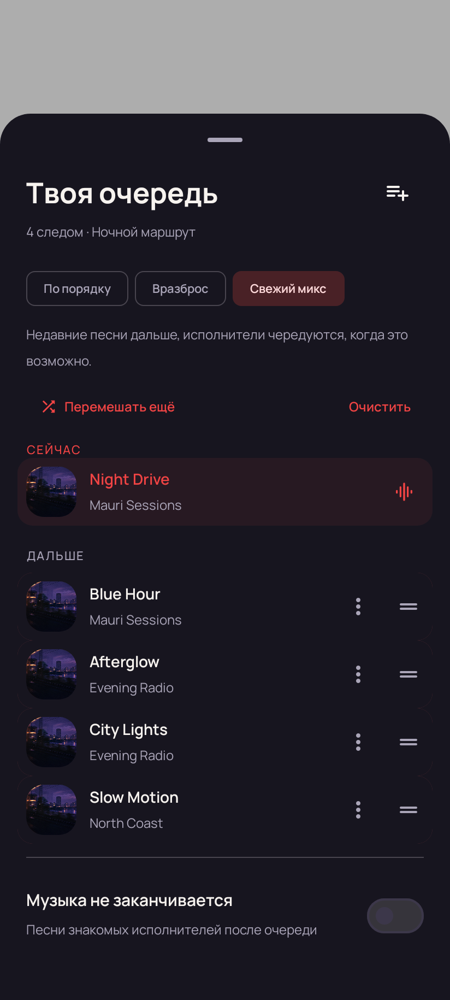

# Mauri

Музыкальный плеер для Android с красивым текстом песен, офлайн-прослушиванием и переносом плейлистов из Spotify. Написан на Kotlin и Jetpack Compose. Без рекламы, без аккаунтов и без серверов: всё хранится на телефоне.

> **English:** Mauri is a free, open-source Android music player (Kotlin, Jetpack Compose, Media3). It plays music found through YouTube Music, shows full-screen synced lyrics coloured to the album art, imports public Spotify playlists, works offline with downloaded songs and keeps all data on the device. The interface is in Russian. Licensed under GPL-3.0-or-later.

<p align="center">
  
  
  
  
</p>

## Возможности

**Музыка**
- Поиск песен в YouTube Music и воспроизведение лучшего доступного аудиопотока (обычно Opus около 160 кбит/с).
- Если запись не играет, Mauri сам переключается на другую подходящую. Версию можно выбрать вручную: альбомную, клип, live.
- Фоновое воспроизведение, уведомление, экран блокировки, гарнитура, Android Auto и голосовой запуск («Включи … в Mauri»).
- Плавный переход между песнями, выравнивание громкости и эквалайзер с готовыми пресетами.
- Виджет на главный экран: обложка, прогресс, перемотка, пауза, лайк.

**Текст песен**
- Полноэкранный текст на фоне цветов обложки, как в Spotify и Apple Music. Текущая строка подсвечивается и заполняется по мере пения.
- Синхронный текст из YouTube Music и LRCLIB с проверкой качества: «фальшивая» синхронизация отбрасывается.
- Подгонка вручную: отмечаешь несколько строк по ходу песни, и текст идёт в такт даже в длинном клипе со вставками.
- Перевод строк на русский, картинка со строкой для отправки, сохранение текстов для офлайна.

**Коллекция**
- Избранное, плейлисты, история, умные подборки и «Микс дня».
- Импорт публичных плейлистов Spotify по ссылке (без входа в аккаунт), а также ссылок Яндекс Музыки, Apple Music и CSV (например, из Exportify).
- Скачивание песен и плейлистов для прослушивания без интернета, а также воспроизведение своих аудиофайлов.
- Очередь с перетаскиванием, свайпами и тремя режимами: по порядку, вразброс и «Свежий микс».
- Статистика прослушиваний «Твой ритм» и итоги года. Считаются только на телефоне и отключаются в настройках.
- Перенос всего одним файлом на новый телефон.

## Установка

Скачай APK из раздела [Releases](../../releases) и открой его на телефоне с Android 8.0 или новее. Android попросит разрешить установку из этого источника.

Новые версии ставятся поверх старых, и данные сохраняются. Удалять приложение перед обновлением не нужно.

## Сборка из исходников

Нужны JDK 17 или новее и Android SDK 36 (Build Tools 36.0.0). Проще всего открыть проект в Android Studio.

```bash
./gradlew :app:assembleDebug           # отладочная сборка
./gradlew :app:testDebugUnitTest       # тесты (сетевые тесты по умолчанию пропускаются)
./gradlew :app:assembleRelease         # релизная сборка с R8
```

Сетевые тесты с реальными сервисами можно включить флагом `-PmeloLive=true`.

### Подпись

Без настроек обе сборки подписываются стандартным отладочным ключом твоего компьютера (`~/.android/debug.keystore`). Для собственного ключа положи в корень проекта файл `keystore.properties` (он не попадает в Git):

```properties
storeFile=keystore/my-release.jks
storePassword=…
keyAlias=…
keyPassword=…
```

APK, подписанный другим ключом, не установится поверх официальной сборки. Сначала придётся удалить приложение, и данные пропадут, поэтому перед этим сохрани всё через «Настройки → Перенос на новый телефон».

## Как это устроено

| Часть | Где в коде |
| --- | --- |
| Поиск и подбор записи, выбор лучшего потока | `data/MusicRepository.kt`, `data/TrackMatcher.kt` |
| Тексты песен: источники, проверка, кэш | `data/LyricsRepository.kt` |
| Ручная подгонка текста | `data/LyricSync.kt`, `ui/LyricsStage.kt` |
| Воспроизведение, очередь, Android Auto, виджет | `playback/` |
| Импорт плейлистов | `data/SpotifyImporter.kt`, `data/SpotifyPlaylistPages.kt`, `data/LinkImporter.kt` |
| Библиотека, загрузки, статистика, настройки | `data/LibraryStore.kt`, `data/OfflineStore.kt`, `data/ListeningStats.kt`, `data/AppSettings.kt` |
| Интерфейс (Compose) | `ui/` |

Все пути указаны относительно `app/src/main/java/app/melo/music/`. Идентификатор пакета `app.melo.music` остался от раннего названия Melo и сохранён, чтобы обновления ставились поверх старых версий.

## Ограничения и отказ от ответственности

- Mauri не связан с YouTube, Google, Spotify, Яндексом, Apple или LRCLIB. Он пользуется их общедоступными страницами и интерфейсами так же, как браузер. Если сервис что-то изменит, поиск, воспроизведение или импорт могут временно перестать работать.
- Приложение не обходит DRM и платные подписки и не даёт доступа к закрытому контенту. Уважай авторские права и условия сервисов в своей стране.
- Lossless-качества нет: звук такой, какой отдаёт источник.
- Chromecast пока не поддерживается.

## Конфиденциальность

У Mauri нет своих серверов, аналитики и рекламы. Библиотека, статистика и настройки лежат только на телефоне. Запросы уходят напрямую к источникам музыки и текстов. Если приложение упало, при следующем запуске оно предложит поделиться отчётом об ошибке. Отправить его можно только вручную, и в нём нет твоих данных.

## Участие

Сообщения об ошибках и идеи пиши в [Issues](../../issues). Как предложить изменение, описано в [CONTRIBUTING.md](CONTRIBUTING.md).

## Лицензия

Mauri распространяется по лицензии [GNU GPL v3.0 или новее](LICENSE), потому что использует [NewPipe Extractor](https://github.com/TeamNewPipe/NewPipeExtractor). Сторонние компоненты и их лицензии перечислены в [THIRD_PARTY_NOTICES.md](THIRD_PARTY_NOTICES.md), а происхождение картинок описано в [ASSETS.md](ASSETS.md).
